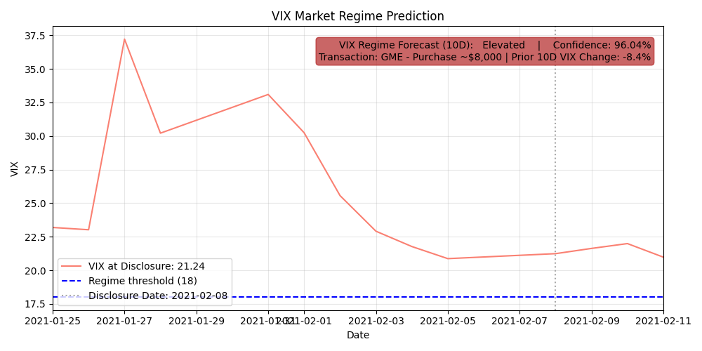

# 🏛️ CapitolRegime

Transforming congressional stock disclosures into forward-looking volatility insights. CapitolRegime combines public disclosure data, market indicators, and machine learning to forecast future VIX volatility regimes.


[Quick Start](#quick-start) • [Interpreting Results](#interpreting-results) • [Configuration Guide](#configuration-guide) • 
[System Requirements](#system-requirements) •  [Required Data Files](#required-data-files) • [Attribution & Disclamer](#attribution--disclaimer)
## Project Overview

> ***No one knows the future with certainty. Not traders, not economists, and occasionally not even the Federal Reserve.***

This AI/ML system uses publicly available congressional stock transaction data and market indicators to predict
whether the CBOE Volatility Index (VIX) will be in a **Normal** or **Elevated** volatility regime 10 trading days after 
a transaction's disclosure date.

The program uses logistic regression to classify future VIX regimes. It evaluates model performance using 
chronological training and testing data, cross-validation, hypertuning, and classification metrics.

The application is intended as a decision-support tool for investment professionals. Its predictions are not financial 
advice and should not replace independent analysis or investment judgment. While no model can predict the future with
certainty, a disciplined process can help transform uncertainty into insight.

---

## Features

* **10-Trading-Day Volatility Regime:** Predicts whether market volatility will be Normal or Elevated 10 trading days after a congressional transaction is disclosed.  
- **Research-Friendly Workflow** - Chronological validation, cross-validation, and comprehensive model evaluation metrics.
* **Simple Configuration** - Adjust transactions, datasets, and model settings from a centralized configuration block.
- **Interactive Model Comparison:** Compare baseline and optimized models to see how different configurations affect predictive performance.  
* **Modular Data Pipeline** - Separate feature engineering, model evaluation, and forecast generation into reusable components.
- **Automated Reporting** - Produce forecasts, diagnostics, logs, and optional visualizations with graceful fallback to console output.
  
---
## Quick Start

This application combines congressional stock transaction disclosures with historical market behavior to generate 
forward-looking forecasts of VIX volatility regimes. While the software was built with investment professionals and 
researchers in mind, it is equally accessible to other market enthusiasts interested in exploring 
volatility forecasting techniques.


### 1. Download Project & Install Requirements

If you do not already have a copy of the project downloaded, Open a terminal or your IDE's built-in terminal 
(such as PyCharm). Navigate to the location where you'd like to store the project, then run:
```bash
# Clone the repository (If Needed)
git clone https://gitlab.com/wgu-gitlab-environment/student-repos/klund28/d683-advanced-ai-and-ml.git

cd d683-advanced-ai-and-ml

git checkout working-branch
```
- If git is unavailable, you can also download the project directly from [GitLab](https://gitlab.com/wgu-gitlab-environment/student-repos/klund28/d683-advanced-ai-and-ml.git)
  by selecting Code -> Download ZIP, then extract the archive to your desired directory and open the project 
  folder.
  
**Next**, create a Python virtual environment:
```
# Create virtual environment
python -m venv venv

# Activate virtual environment
venv\Scripts\activate    # Linux/macOS: source venv/bin/activate
```

**Lastly**, install the required packages listed in requirements.txt. This file contains all Python dependencies needed
to run the application:
```bash
# Install required packages
pip install -r requirements.txt
```
- Alternatively, if you prefer to install dependencies manually see the [Python Dependencies](#python-dependencies) guide for a detailed list of
  required packages and alternative installation methods.
<br>

### 2. Configure the Application
The application's primary settings are consolidated into a dedicated **[User Configuration](#configuration-guide)** 
section (**lines 315-339**) within main.py. If you're using PyCharm, consider collapsing the surrounding code
**(Right Click -> Folding -> Collapse All)** or **(Ctrl + Shift + -)** to quickly locate the configuration block.

* ####*For your first run, the default settings are recommended.*

The application expects the master dataset to be located in the project files inside the `CSV_data` directory:

```text
project/
├── main.py
└── CSV_data/
    └── master_dataset.csv
```
- If the .csv file is stored elsewhere, update the dataset path in the User Configuration section before launching the
  application.
<br>
  
### 3. Generate Your First Forecast
You're ready to generate your first forecast. From the project directory, run:
```bash
python main.py
```
- Alternatively, open main.py in PyCharm and click the **Run** button (usually a green triangle in the top-right of the
  window).
---
---

### Interpreting Results

Predictions are presented in two formats:

1. **Graphical Output:** When supported by the system, a VIX chart displays volatility trends around
   the transaction's disclosure date, alongside a text box containing the prediction results.
2. **Console Output:** The prediction details are printed directly to the console.

The console output serves as a fallback when graphical output is unavailable. When a graph is
displayed, the prediction details are printed to the console after the graph window is closed.

#### Example Graph Output:



#### Example Text Output:
```text
Model: Optimized Logistic Regresstion
=====================================
VIX Regime Forecast (10D): Elevated
Confidence: 96.04%
VIX at Disclosure: 21.24
Prior 10D VIX Change: -8.4%
Disclosure Date: 2021-02-08
Transaction: GME - Purchase  ~$8000.0
```
#### Understanding the VIX regime:
`VIX Regime Forecast (10D): Elevated`
- The model classifies market conditions into one of two regimes: Normal or Elevated. An **Elevated**
  regime is defined in code as a VIX value greater than 18. A **Normal** regime represents a VIX value of 18 or below.
  
- The prediction represents the expected 
  volatility regime 10 trading days after the transaction's disclosure date. It does not describe 
  how the VIX may fluctuate during the 10 trading day period or predict the exact VIX value at the end
  of that period.
  
- Keep in mind that the model predicts a market volatility regime not whether a congressional stock transaction will be
  profitable. Its purpose is to provide insight into potential market conditions, not to forecast the performance of an
  individual stock or trade.
  
<br>

#### Predicted-Class Probability
`Confidence : 96.04%`
- The Predicted-Class Probability represents the model's estimated probability of its predicted VIX regime, based on
  patterns learned during training. For example, a probability of 96% means the model assigns a 96% probability to 
  the predicted class, Elevated. This indicates strong model confidence in the classification, but it does not guarantee
  that the prediction will be correct. Conversely, a probability of 55% indicates lower model confidence, meaning the 
  model is less certain about its prediction. A lower probability does not necessarily mean the prediction is likely to 
  be wrong; it means the model has less confidence in its predicted class.

#### Prior 10-trading-day VIX percent Change
`Prior 10D VIX Change: -8.4%`
- Measures the percentage change in the VIX over the 10 trading days after a transaction's disclosure. This helps in
  providing context on whether market volatility was rising (positive value) or falling (negative value) and the 
  magnitude of the direction.

<br>

#### Transaction Details:
`VIX at Disclosure: 21.24`
- The VIX value at the time of public disclosure provides a baseline for understanding market volatility 
  around the transaction report.
  
`Disclosure Date: 2021-02-08`
- The date the congressional transaction was publicly reported. This date establishes the starting 
  point for the model's prediction. It is important to distinguish the disclosure date from the transaction date, as the
  transaction may have occurred weeks or months before it became public
  
`Transaction: GME - Purchase  ~$8000.0`
- Transaction identifies the reported congressional trading activity, including the stocks ticker symbol (GME-Gamestop),
  transaction type (Purchase or Sale) and the dollar amount of the reported congressional disclosure range (Midpoint = 
  $8,000.00). This provides context for the transaction being analyzed but does not indicate whether the individual trade is expected to 
  be profitable.
  
>Note: Transaction amounts shown by the application are estimated using the midpoint of the congressional disclosure
> range and may not reflect the exact transaction value.
---

## Configuration Guide
The application features a **User Configuration** section inside of `main.py`. This section serves as the application's
main control center. From here you can:
- Configure dataset paths.
- Select congressional transaction inputs.
- Enable/disable models.
- Activate system logging of model metrics.
- Configure model evaluation cutoff dates.

In `main.py`, locate the **USER CONFIGURATION** section (Code **Lines 315-339**) by scrolling down the page or collapsing the 
surrounding code: 
>**(Right Click -> Folding -> Collapse All)** or **(Ctrl + Shift +  - )**.

```python
# ================================ USER CONFIGURATION ========================================
DATASET_PATH = Path("CSV_data") / "master_dataset.csv"  # Configure Datasource Path

# TRANSACTION SELECTION (True: Custom transaction | False: Most recent dataset transaction)
user_transaction = False

# CUSTOM TRANSACTION DETAILS (Active only when user_transaction = True)
member = "Nancy Pelosi"                      # Congress members name (Case Sensitive)
ticker = "NVDA"                              # Stock ticker symbol
transaction_date = "2023-11-22"              # Transaction date (YYYY-MM-DD)
disclosure_date = "2023-12-21"               # Disclosure date (YYYY-MM-DD)
transaction_type = "Purchase"                # Transaction type: "Purchase" or "Sale"
transaction_range = "$1,000,001-$5,000,000"  # Disclosed trade value range

# MODEL ENGINE SELECTION (Enable either or both models to generate predictions)
use_baseline_model = True   # Enable/Disable Baseline Logistic Regression
use_tuned_model = True      # Enable/Disable Tuned Machine Learning Model

# EVALUATION SETTINGS (Current chronological cutoff range: 2014-01-03 to 2026-04-08)
evaluation_cutoff = [True, "2022-01-01"]
log_testset_evaluation = True  # Log additional details about test-set evaluation
```

> ***Note on Data Formatting & Processing:*** Ensure all custom transaction metadata fields 
> (`member`, `ticker`, `transaction_date`, `disclosure_date`, `transaction_type`, and `transaction_range`) are enclosed in double
> quotes ("..."). `alpha_prep.py` relies on these raw string inputs to fetch historical price context
> and transform the trade into a structured feature row that the predictive model can process.

<br>

#### Boolean Toggles

| Toggle Variable | State | Description |
| :--- | :--- | :--- |
| **`user_transaction`** | `True` | Predicts custom trade data defined in **Transaction Information**. |
| | `False` | Predicts the most recent trade in the dataset. |
| **`use_baseline_model`** | `True` | Runs the un-tuned baseline logistic classification model. |
| | `False` | Excludes the baseline model from execution, logging, and output. |
| **`use_tuned_model`** | `True` | Runs the hyperparameter-tuned logistic classification model. *(Requires `evaluation_cutoff` to be enabled).* |
| | `False` | Excludes the tuned model from execution, logging, and output. |
| **`evaluation_cutoff`** | `[True, "YYYY-MM-DD"]` | Enables a custom chronological cutoff date for model evaluation.<br> **Current Range of master_dataset.csv:** `2014-01-03` to `2026-04-08`<br> *(Required if `use_tuned_model = True`).* |
| | `[False, ...]` | Disables custom date cutoffs for model evaluation. |
| **`log_testset_evaluation`** | `True` | Enables test-set evaluation metrics to automatically be posted in the log file. |
| | `False` | Disables detailed evaluation logging. |

**Important:** The configuration of `evaluation_cutoff` affects how results should be interpreted. In particular, 
distinguish historical model evaluation from predictions for a specific transaction. The evaluation cutoff determines 
the historical training and testing periods; it is not the date used to generate a prediction.

> **Dependency Note on Evaluation Cutoff & Data Leakage:** `use_tuned_model = True` requires `evaluation_cutoff` to be
> set to `[True, "YYYY-MM-DD"]` so the model grid search has a valid cross-validation date limit. Always maintain a 
> sufficient chronological gap between evaluation_cutoff and your disclosure_date. Setting the cutoff too close to the
> disclosure date (e.g., the day before) restricts the evaluation window, leading to deceptively inflated accuracy 
> metrics that fail to reflect how the model actually performs on unseen market data.

---

## System Requirements

### Hardware Requirements

The program is lightweight and runs comfortably on most modern systems.

| Component | Requirement |
|------------|------------|
| Processor | Modern dual-core CPU or better |
| Memory | 4 GB RAM minimum (8 GB recommended) |
| Storage | 100 MB minimum; additional space required for optional historical market datasets |
| Display |  Monitor for graphical output, alphanumeric display for text output |
> Most memory usage comes from model training, cross-validation, and intermediate data processing rather than raw
> dataset size.

### Software Requirements

| Component | Required | Purpose |
|------------|------------|------------|
| Python 3.9+ | Yes | Application runtime environment |
| pandas | Yes | Data loading, manipulation, and feature engineering |
| scikit-learn | Yes | Model training, preprocessing, cross-validation, hyperparameter tuning, and evaluation |
| matplotlib | Optional | Chart generation and visualization |
| alpha_prep.py | Custom Transactions Only | Generates custom transactions and appropriate features using historical congressional / market data |

### Dependency Installation

The recommended installation method is:
```bash
pip install -r requirements.txt
```
If dependency installation fails, you can install packages individually:
```bash
pip install pandas
pip install scikit-learn

# Optional: Required only for graphical output
pip install matplotlib
```
### Python Dependencies

| Package | Import Alias | Purpose |
|----------|----------|----------|
| pandas | `pd` | Data loading, manipulation, and feature engineering |
| scikit-learn | `sklearn` | Model training, preprocessing, cross-validation, hyperparameter tuning, and evaluation |
| matplotlib | `plt` | Chart generation and visualization |

---

## Required Data Files

The application requires a copy of `master_dataset.csv` to train models, evaluate performance, and generate forecasts.

Additional historical market datasets are optional but recommended when analyzing custom congressional transactions, as they enable the application to generate a richer set of predictive features.

### Operating Modes

- **Standard Mode** (`user_transaction = False`)
  Uses the pre-engineered features contained within `master_dataset.csv` and requires no additional market data files.

- **Custom Transaction Mode** (`user_transaction = True`)
  Generates features for a user-supplied congressional transaction using available historical market data.
  
> Custom Forecasts can still be generated without the optional datasets, although predictive performance may be reduced.
CapitolRegime requires access to `master_dataset.csv` for model training, evaluation, and forecast generation.

### Dataset Reference

| Dataset | Required | Purpose | Source |
|----------|----------|----------|----------|
| `master_dataset.csv` | **YES** | Model training, evaluation, and forecasts | [Project Repository](https://gitlab.com/wgu-gitlab-environment/student-repos/klund28/d683-advanced-ai-and-ml/-/blob/working-branch/CSV_data/master_dataset.csv?ref_type=heads) |
| Historical VIX Data | No | Generates supplemental VIX-based features | [Kaggle](https://www.kaggle.com/datasets/guillemservera/vix-cboe-volatility-index-daily-updated) |
| Stooq Market Data | No | Generates stock-specific market features for custom transactions | [Stooq](https://stooq.com/db/h/) |

**Default CSV data directory structure:**
```text
CSV_data/
├── master_dataset.csv
├── VIX_data.csv
└── Stooq Market Data/
```

### Optional Historical Market Data

Historical market datasets are only required when generating regimes for custom congressional transactions. These 
datasets allow the application to create market and volatility features that improve predictive performance.

Historical VIX data is provided as a single .csv file and can be referenced directly at the bottom of `aplha_prep.py` :
```python
VIX_PATH = Path("path/to/VIX_History.csv")
```

### Optional Stooq Market Data

Unlike the other datasets used by the application, Stooq does not provide a single consolidated CSV file. Instead, 
historical price data is organized into directories containing individual text files for each ticker symbol. This means
that `STOOQ_PATH` should point to the root Stooq data directory rather than a specific file. The Stooq root folder can
be referenced directly at the bottom of `alpha_prep.py`:
```python
STOOQ_PATH = Path(r"path/to/stooq/data/daily/us")
```
Example Stooq file hierarchy:
```text
CSV_data/
├── master_dataset.csv
└── Stooq Market Data/
    └── daily/
        └── us/
            ├── indices/
            │   ├── spx.txt
            │   └── ...
            └── stocks/
                ├── aapl.us.txt
                ├── gme.us.txt
                ├── msft.us.txt
                ├── nvda.us.txt
                └── ...
```

Unlike the other datasets used by `alpha_prep.py`, Stooq market data is distributed across thousands of individual
ticker files. The system scans the Stooq `us/` directory, builds a ticker-to-file mapping, and retrieves the appropriate
historical price ticker file.

>**Note**: alpha_prep.py discovers ticker files using `STOOQ_PATH.rglob("*.us.txt")`. Files that do not follow the 
> .us.txt naming convention (e.g, .jp.txt) will ****not**** be included in the generated ticker map.

### Missing Data Handling

The custom transaction pipeline is designed to handle incomplete data gracefully.

If optional market datasets are unavailable, missing features are retained as NaN values and processed by the model's 
preprocessing pipeline. Regimes can still be generated, although predictive performance will most likely be reduced
due to the smaller feature set.

Transactions with missing feature values are recorded in the log output. The log identifies which stock-specific or 
market-index data could not be generated and notes that prediction continued using the available data.

> **Note:** All transaction details in **User Configuration** when using a custom transaction are **REQUIRED**, the 
> program can not generate additional details about the transaction without those required fields.


## Attribution & Disclaimer

### Data Sources

This project utilizes publicly available congressional transaction disclosures and market datasets from third-party providers. All data remains the property of its respective owners and is used for research and educational purposes.

Contributors to this project do not claim ownership of any third-party datasets referenced throughout this repository.

### Educational & Research Use

CapitolRegime was developed as a machine learning and research project designed to explore potential relationships 
between congressional stock disclosures and future market volatility conditions.

The application should be viewed as a research and decision-support tool rather than a predictive authority.

### No Financial Advice

Forecasts, classifications, confidence scores, visualizations, and performance metrics generated by this application are
provided for informational and educational purposes only.

Nothing contained within this repository constitutes investment advice, financial advice, legal advice, or a 
recommendation to buy, sell, or hold any security. Users should conduct their own research and consult with
professionals before making investment decisions.

Past performance does not guarantee future results, and model forecasts can be **incorrect**.